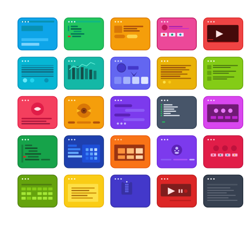
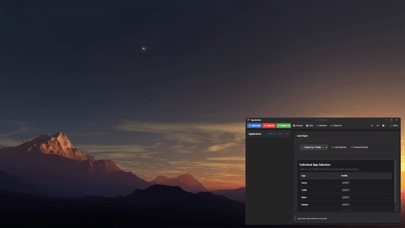
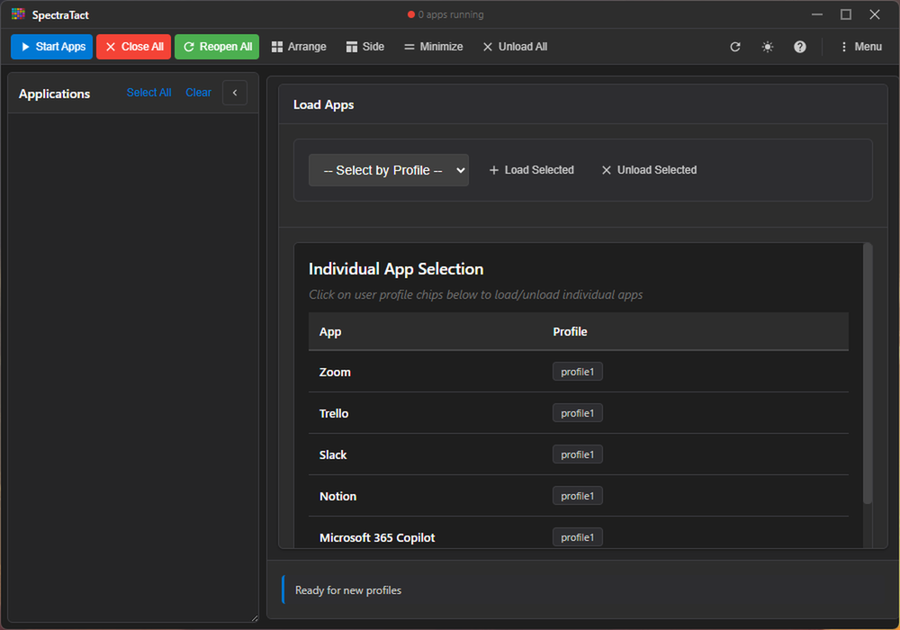
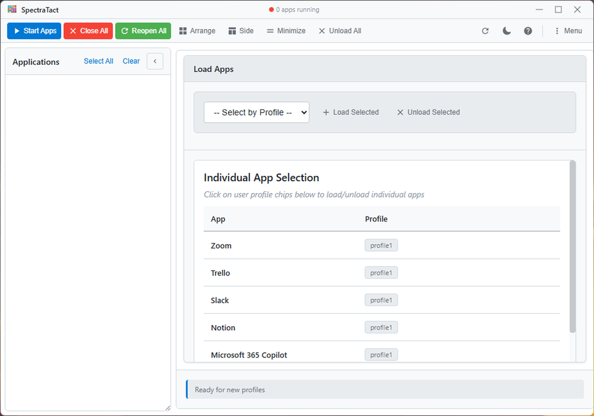
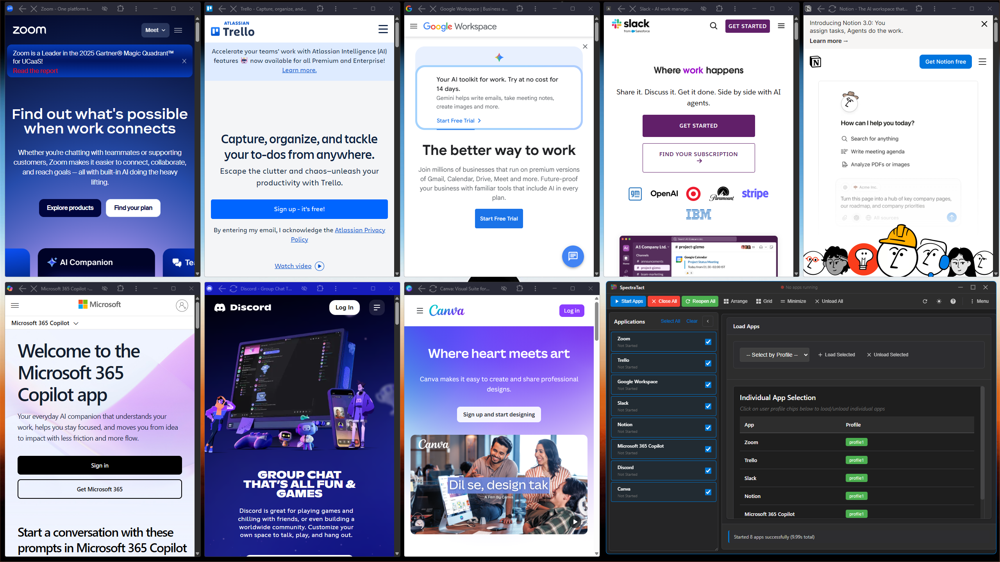
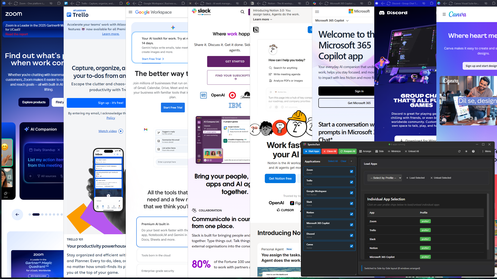

<p align="center">
  
</p>

<h1 align="center">SpectraTact</h1>

<p align="center">
  <a href="https://github.com/dhaneshbb/spectratact/releases"></a>
  <a href="LICENSE"></a>
  <a href="https://github.com/dhaneshbb/spectratact"></a>
  <a href="https://www.python.org/"></a>
  <a href="https://nodejs.org/"></a>
  <a href="https://www.electronjs.org/"></a>
</p>

<p align="center">Desktop application manager with intelligent window orchestration for Windows.</p>



## Overview

SpectraTact manages and arranges desktop applications through automated window management. Launch multiple applications and organize them in grid or side-by-side layouts with configurable profiles and multi-monitor support.

**Key Features:**

- Launch and arrange multiple applications in defined layouts
- Grid layout (NxM matrix) and side-by-side layouts (horizontal/vertical split)
- Multi-monitor support (span, distribute, primary overflow modes)
- Profile-based application management with priority ordering
- Keyboard shortcuts for common operations
- Dark and light themes

| Dark Theme | Light Theme |
|------------|-------------|
|  |  |

| Grid Layout | Side-by-Side Layout |
|-------------|---------------------|
|  |  |

## Quick Start

### Installation

**From Release:**

Download from releases page:
- NSIS installer: `SpectraTact-v0.1.0-Setup.exe`
- Portable: `SpectraTact-v0.1.0-Portable.exe`

**From Source:**

```bash
git clone https://github.com/dhaneshbb/spectratact.git
cd spectratact
pip install -r requirements.txt
npm install
npm run dev:win
```

See [Installation Guide](docs/installation.md) for details.

### Configuration

On first run, copy configuration examples:

```bash
cp docs/examples/settings.example.yml config/settings.yml
cp docs/examples/loaded_apps.example.yml config/loaded_apps.yml
cp docs/examples/load_apps.example.yml config/load_apps.yml
```

Edit `config/loaded_apps.yml` to add application profiles:

```yaml
apps:
  - name: "Gmail"
    app_path: "C:\\shortcuts\\Gmail.lnk"
    keywords: ["Gmail", "Google Chrome"]
    priority: 1
    enabled: true
```

See [Configuration Guide](docs/configuration.md) for all options.

### Basic Usage

1. **Start Applications:** Select apps and click Start (Ctrl+S)
2. **Arrange Windows:** Click Arrange (Ctrl+G) to reposition
3. **Minimize/Restore:** Minimize all to taskbar or restore to positions
4. **Close Applications:** Close all managed applications

See [User Guide](docs/user-guide.md) for operations and features.

## Architecture

Hybrid Python + Electron application:

- **Python Backend:** Window management using pywin32 (detection, positioning, layout calculation)
- **Electron Frontend:** GUI with IPC communication to Python subprocess
- **Communication:** JSON-RPC over stdin/stdout

See [Architecture Guide](docs/architecture.md) for system design and communication flow.

## Documentation

**User Documentation:**

- [User Guide](docs/user-guide.md) - Interface, operations, keyboard shortcuts
- [Configuration Guide](docs/configuration.md) - Settings reference
- [Troubleshooting Guide](docs/troubleshooting.md) - Common issues and solutions

**Developer Documentation:**

- [Developer Guide](docs/developer-guide.md) - Development setup, testing, building
- [Architecture Guide](docs/architecture.md) - System design and data flow
- [API Reference](docs/api-reference.md) - Python and JavaScript API

**Additional Resources:**

- [CHANGELOG.md](CHANGELOG.md) - Version history
- [CONTRIBUTING.md](CONTRIBUTING.md) - Contribution guidelines
- [docs/](docs/) - Full documentation

## Development

### Requirements

- Python 3.8+ (3.8-3.13 supported)
- Node.js 18.0+
- Windows 10/11

### Setup

```bash
pip install -e .[dev]
npm install
pre-commit install
```

### Commands

```bash
# Development
npm run dev:win                    # Run in development mode
python -m spectratact              # Run Python component

# Testing
npm run test                       # All tests (Python + JavaScript)
pytest                              # Python tests only
npm run test:frontend              # JavaScript tests only

# Building
npm run dist:win                   # Build Windows distribution
npm run pack                       # Development build (no installer)

# Code Quality
black src/spectratact              # Format Python code
flake8 src/spectratact             # Lint Python code
mypy src/spectratact               # Type check Python code
npx eslint src/desktop             # Lint JavaScript code
```

See [Developer Guide](docs/developer-guide.md) for workflow details.

## Contributing

Contributions welcome. See [CONTRIBUTING.md](CONTRIBUTING.md) for guidelines.

**Before Contributing:**

1. Read [CONTRIBUTING.md](CONTRIBUTING.md)
2. Check [Issue Templates](.github/ISSUE_TEMPLATE/)
3. Review [Developer Guide](docs/developer-guide.md)
4. Run tests: `npm run test`

## Platform Support

**Current:** Windows 10/11 (pywin32-based window management)

**Planned:** macOS (AppKit), Linux (X11/Wayland)

The Electron GUI is cross-platform ready. Platform-specific implementation needed for window management layer.

## License

GPL-3.0-or-later. See [LICENSE](LICENSE) for details.

Third-party licenses and notices in [THIRD_PARTY_LICENSES.txt](THIRD_PARTY_LICENSES.txt) and [NOTICE](NOTICE).

## Links

- **Repository:** https://github.com/dhaneshbb/spectratact
- **Documentation:** https://github.com/dhaneshbb/spectratact/blob/main/
- **Issues:** https://github.com/dhaneshbb/spectratact/issues
- **Changelog:** [CHANGELOG.md](CHANGELOG.md)

---

Version 0.1.0 | Beta | Python 3.8-3.13 | Node.js 18.0+ | Windows 10/11

Copyright 2025 dhaneshbb. Licensed under GPL-3.0-or-later.
