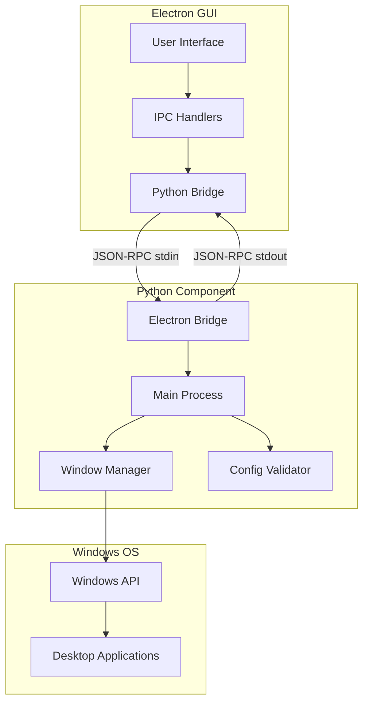
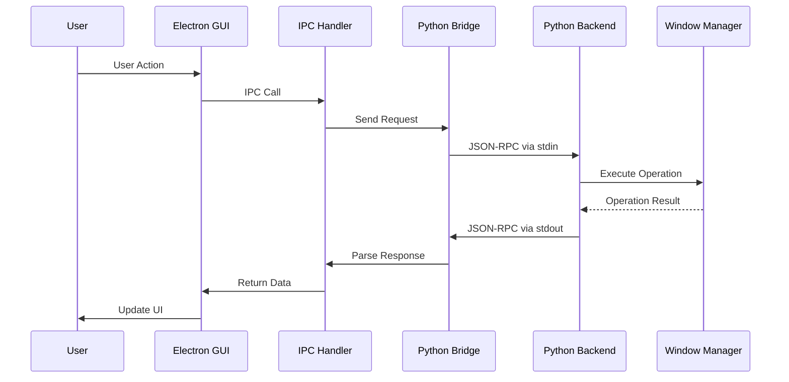
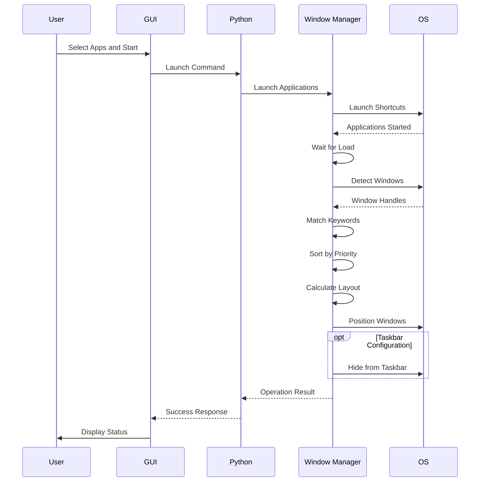
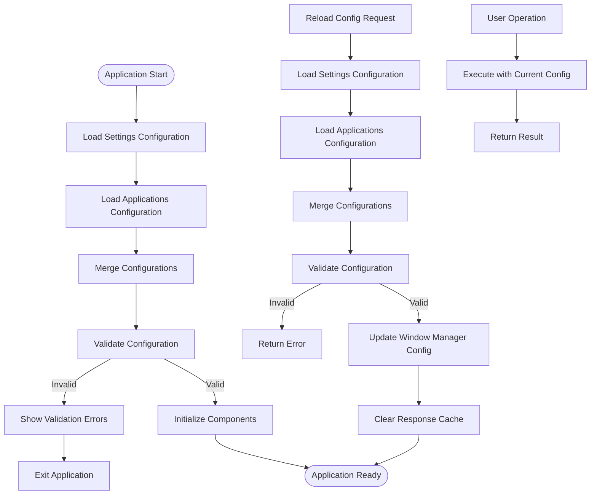
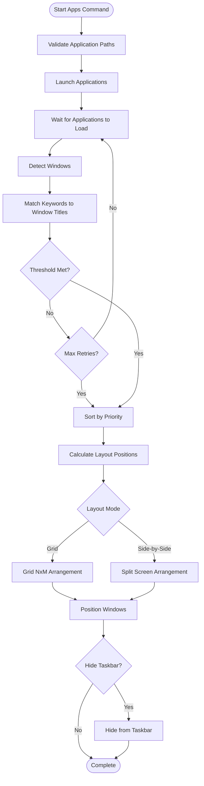

# Architecture Guide

This document describes the system architecture and design of SpectraTact.

- [Architecture Guide](#architecture-guide)
  - [System Overview](#system-overview)
  - [Component Architecture](#component-architecture)
    - [Python Component](#python-component)
    - [Electron GUI](#electron-gui)
  - [Communication Flow](#communication-flow)
    - [JSON-RPC Protocol](#json-rpc-protocol)
    - [Application Launch Flow](#application-launch-flow)
  - [Data Flow](#data-flow)
    - [Configuration Management](#configuration-management)
    - [Window Detection and Arrangement](#window-detection-and-arrangement)
  - [Module Responsibilities](#module-responsibilities)
    - [Python Modules](#python-modules)
    - [Electron Modules](#electron-modules)
  - [State Management](#state-management)
  - [Security Architecture](#security-architecture)
  - [Performance Optimizations](#performance-optimizations)
  - [Extension Points](#extension-points)
  - [Build and Deployment](#build-and-deployment)
  - [See Also](#see-also)

## System Overview

SpectraTact is a hybrid desktop application combining Python window management with an Electron-based GUI, communicating via JSON-RPC over stdin/stdout.

User interacts with Electron GUI, which spawns Python subprocess. Communication occurs via JSON-RPC over stdin/stdout pipes. Python component validates configuration and manages windows through Windows API. Window Manager detects applications, calculates layouts, and positions windows on desktop.

## Component Architecture

### Python Component

**Core Modules:**
- Main entry point with callback registration
- Electron Bridge for JSON-RPC communication (bridge, handlers, cache, profile manager, config manager, file operations)
- Window Manager for window detection and layout
- Configuration validator
- Security and path utilities

### Electron GUI

**Core Modules:**
- Main process: Window management, Python subprocess bridge, IPC handlers, configuration, menu
- Renderer: UI components, application management, profiles, theme, onboarding, events

## Communication Flow

### JSON-RPC Protocol

Request flows from user through GUI to Python backend via JSON-RPC. Python processes request through Window Manager, returns result via stdout. GUI parses response and updates interface. Communication is asynchronous with timeout handling.

### Application Launch Flow

Application launch starts shortcuts via OS, waits for windows to appear, then detects windows using keyword matching. Windows are sorted by priority, positioned according to layout mode (grid or side-by-side), and optionally hidden from taskbar. Result returns to GUI with success status.

## Data Flow

### Configuration Management

Configuration loads from YAML files (settings.yml, loaded_apps.yml), merges, and validates on startup. Invalid configuration prevents application launch. Live reload updates configuration without restart, clears cache, and re-initializes Window Manager with new settings.

### Window Detection and Arrangement

Window detection validates paths, launches shortcuts, waits for windows to appear. Detection uses keyword matching with retry logic until threshold met (80% of apps found). Windows sort by priority, calculate positions based on layout mode, then position and optionally hide from taskbar.

## Module Responsibilities

### Python Modules
- `main.py` - Application entry point and callback registration
- `electron_bridge/` - JSON-RPC communication layer
- `window_manager/` - Window detection, positioning, and layout
- `config/` - Configuration validation and security

### Electron Modules
- `desktop-main.js` - Electron initialization
- `main/` - Python subprocess management and IPC handlers
- `modules/` - UI state and operations

See [API Reference](api-reference.md) for detailed method documentation.

## State Management

**Python State:**
- Window Manager tracks window handles and metadata
- Response cache with TTL for configuration and active apps

**GUI State:**
- Application list with selection state
- Active applications with window handles
- Response cache with TTL for IPC calls

## Security Architecture

**Path Validation:**
- Rejects null bytes, path traversal (`..`), length > 512 chars
- Only `.lnk` files allowed for app launching
- File existence check before execution

**Executable Whitelist:**
- `target_only: true` enforces whitelist in `valid_executables`
- Process name validation during window detection

## Performance Optimizations

**Two-Tier Caching:**
- Python: Configurable TTL (default 1.0s), separate caches for active apps and configuration, oldest-entry eviction with size limits
- GUI: Configurable TTL (default 1s), caches IPC responses, size-limited with automatic trimming, invalidated after operations

**Optimistic Updates:**
- GUI updates immediately before Python confirms
- Background polling syncs actual state periodically

**Adaptive Timing:**
- Launch wait scales with application count
- Detection retry with early exit when threshold met

## Extension Points

**Supported Extensions:**
- New layout modes (grid, side-by-side, custom)
- Additional window operations
- Platform-specific implementations (Windows, macOS, Linux)

See [Developer Guide](developer-guide.md) for implementation details.

## Build and Deployment

**Python Package:**
- PEP 517/518 build with setuptools
- Entry point: `spectratact = "spectratact.main:main"`
- Tests: pytest with coverage

**Electron Build:**
- Windows: NSIS installer + portable
- macOS: DMG + zip (x64, arm64)
- Linux: AppImage, deb, rpm, tar.gz
- Bundles Python source in `extraResources/`

## See Also

- [User Guide](user-guide.md) - Using the application
- [Configuration Guide](configuration.md) - Configuration reference
- [API Reference](api-reference.md) - API documentation
- [Contributing Guide](../CONTRIBUTING.md) - Development workflow

---

Version 0.1.0 | Beta | Python 3.8-3.13 | Node.js 18.0+ | Windows 10/11

Copyright 2025 dhaneshbb. Licensed under GPL-3.0-or-later.
