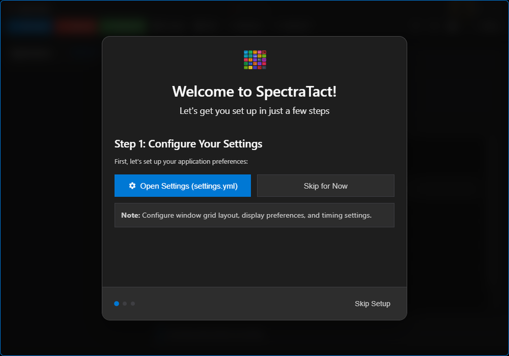
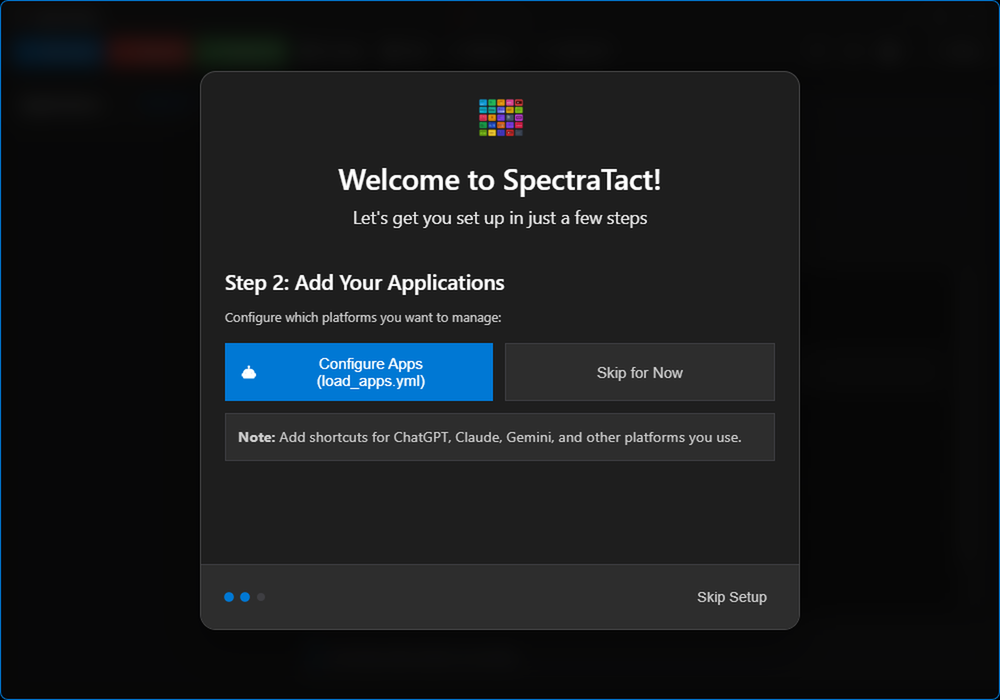
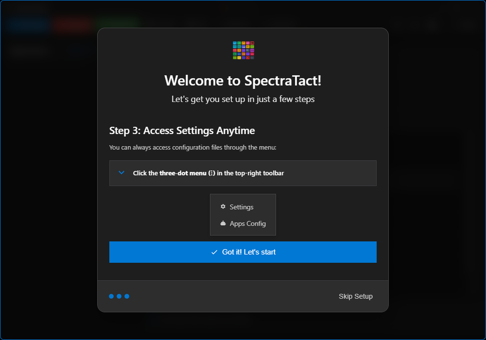

# User Guide

Basic usage of SpectraTact for managing desktop applications.

## Table of Contents

- [Demo](#demo)
- [Interface](#interface)
- [Operations](#operations)
- [Layouts](#layouts)
- [Profiles and Priorities](#profiles-and-priorities)
- [Multi-Monitor](#multi-monitor)
- [Configuration](#configuration)
- [Keyboard Shortcuts](#keyboard-shortcuts)
- [See Also](#see-also)

## Demo


## First Run Onboarding

On first launch, SpectraTact displays a setup wizard to guide you through initial configuration:

| Step 1 | Step 2 | Step 3 |
|--------|--------|--------|
|  |  |  |
| Welcome screen with getting started information | Configuration options and settings | Final setup completion |

## Interface

**Toolbar buttons:**
- Start - Launch and arrange applications
- Minimize - Minimize all to taskbar
- Restore - Restore minimized windows
- Arrange - Rearrange running windows
- Close - Close all applications
- Refresh - Update status

**Left panel:**
- Application list with checkboxes
- Select apps for operations
- Drag to reorder priority

**Status bar:**
- Current operation status
- Counts and timing

**Themes:**
Light and dark modes available (theme setting in config).

| Dark Theme | Light Theme |
|------------|-------------|
|  |  |

## Operations

**Start applications:**
1. Check boxes for apps to launch
2. Click Start
3. Apps launch and arrange per layout mode

**Arrange windows:**
Click Arrange to reposition running windows.

**Minimize/Restore:**
- Minimize: Minimize all to taskbar
- Restore: Restore to previous positions
- Taskbar hiding: Controlled by `taskbar.hide_apps` config

**Close applications:**
- Close all: Click Close button
- Close specific: Right-click app → Close

**Refresh status:**
Click Refresh to detect currently running apps.

## Layouts

| Grid Layout | Side-by-Side Layout |
|-------------|---------------------|
|  |  |
| Rows and columns matrix (e.g., 5x2 = 10 windows) | Horizontal or vertical split with configurable ratio |

## Profiles and Priorities

**Profiles:**
Applications can have multiple profiles (different shortcuts, keywords, priorities).
Configured in `load_apps.yml`, loaded into `loaded_apps.yml`.

**Priority:**
Lower number = arranged first (priority 1 → top-left in grid).
Unique priorities required per app.
Drag apps in left panel to reorder.

## Multi-Monitor

**Display modes:**
- `span` - Treat all monitors as one canvas
- `distribute` - Evenly spread windows across monitors
- `primary_overflow` - Fill primary first, then overflow

**Configuration:**
```yaml
window:
  display:
    preferred_display: "1,2"
    multi_display_mode: primary_overflow
```

See [Configuration Guide](configuration.md).

## Configuration

**Reload configuration:**
- Menu: File → Reload Configuration
- Shortcut: Ctrl+R
- Changes apply without restart

**Config files:**
- `config/settings.yml` - Application settings
- `config/loaded_apps.yml` - Active profiles
- `config/load_apps.yml` - Profile library

## Keyboard Shortcuts

- Ctrl+S - Start all applications
- Ctrl+R - Refresh apps
- Ctrl+A - Select all applications
- Ctrl+D - Clear application selection
- Ctrl+G - Arrange windows in grid layout

## See Also

- [Configuration](configuration.md) - Settings reference
- [Troubleshooting](troubleshooting.md) - Common issues
- [Installation](installation.md) - Setup

---

Version 0.1.0 | Beta | Python 3.8-3.13 | Node.js 18.0+ | Windows 10/11

Copyright 2025 dhaneshbb. Licensed under GPL-3.0-or-later.
